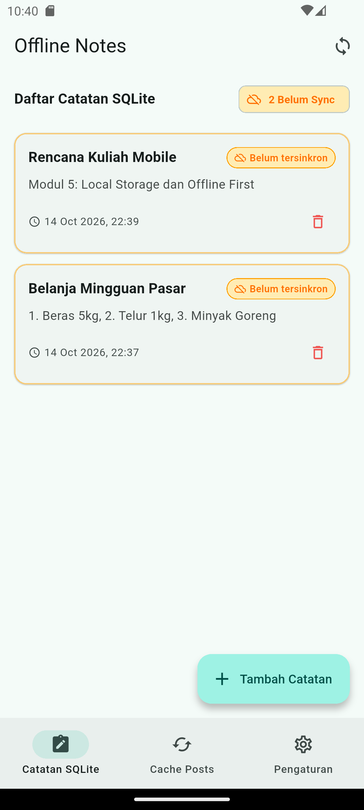
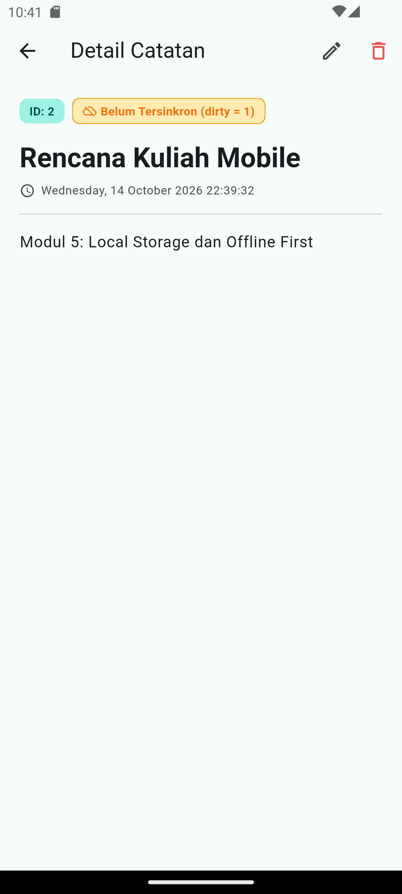
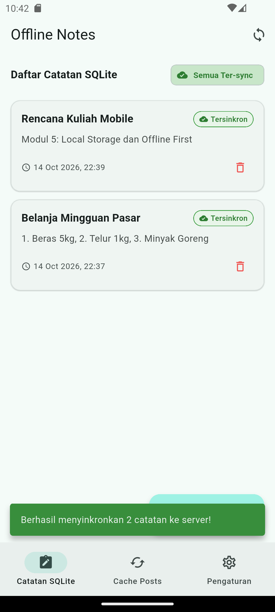
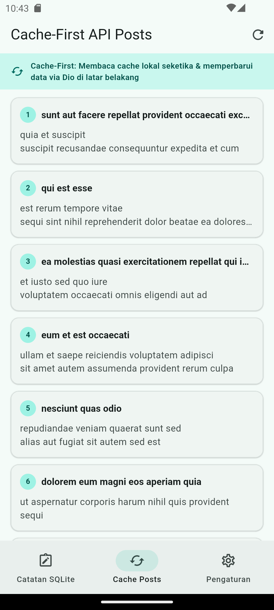
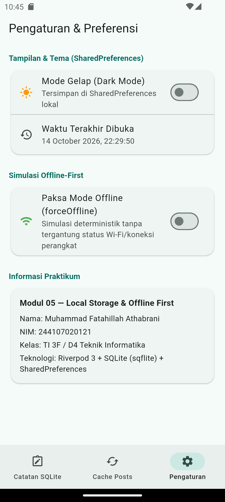
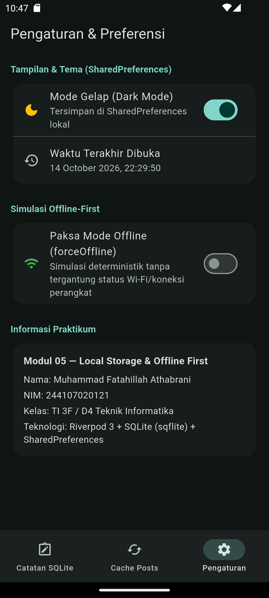
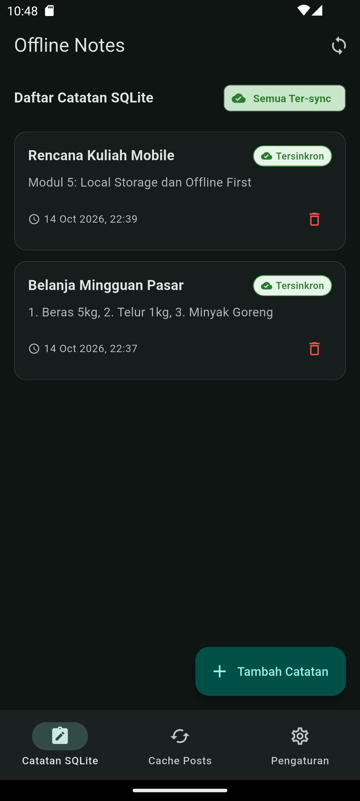
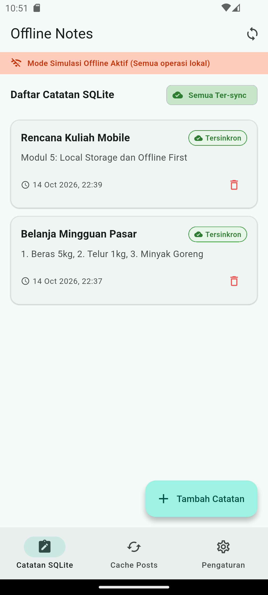
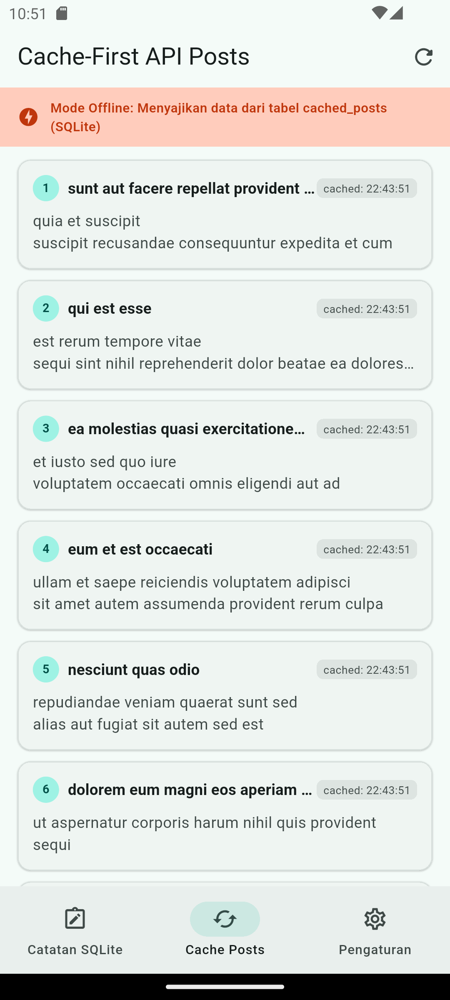

# Laporan Modul 05 — Local Storage & Offline-First

Repositori ini mendokumentasikan pengerjaan modul praktikum ke-5, mencakup implementasi penyimpanan lokal persisten menggunakan **SharedPreferences** untuk preferensi, **SQLite (`sqflite`)** untuk data relasional catatan, arsitektur **Offline-First** dengan strategi *cache-first read*, penanda *dirty flag*, antrean sinkronisasi (*sync queue*), manajemen state menggunakan **Riverpod**, serta navigasi antar halaman menggunakan **GoRouter**.

---

## 👤 Informasi Mahasiswa
* **Nama Lengkap:** Muhammad Fatahillah Athabrani
* **NIM:** 244107020121
* **Program Studi:** D4 Teknik Informatika
* **Kelas:** TI 3F
* **Mata Kuliah:** Pemrograman Mobile 

---

## 📌 Peta Pembahasan
1. [Ikhtisar Pembelajaran](#1-ikhtisar-pembelajaran)
2. [Hierarki Direktori Proyek](#2-hierarki-direktori-proyek)
3. [Tugas Utama — Local Storage & Arsitektur Offline-First](#3-tugas-utama--local-storage--arsitektur-offline-first)
4. [AI Challenge & Verification Checklist](#4-ai-challenge--verification-checklist)
5. [Refleksi](#5-refleksi)
6. [Pengujian Otomatis (Testing)](#6-pengujian-otomatis-testing)
7. [Dokumentasi Visual (Screenshot)](#7-dokumentasi-visual-screenshot)
8. [Instruksi Menjalankan Aplikasi](#8-instruksi-menjalankan-aplikasi)
9. [Rangkuman Akhir](#9-rangkuman-akhir)

---

## 1. Ikhtisar Pembelajaran
Pada praktikum ini, dipelajari secara mendalam bagaimana merancang dan membangun aplikasi Flutter yang tangguh dan tetap berfungsi optimal tanpa bergantung pada koneksi internet (*offline-first*):
* **Penyimpanan Key-Value (`SharedPreferences`)**: Digunakan secara terisolasi untuk menyimpan konfigurasi dan preferensi ringan seperti toggle tema gelap/terang (*dark mode*) dan stempel waktu (*timestamp*) aplikasi terakhir dibuka.
* **Penyimpanan Relasional (`sqflite`)**: Digunakan untuk menyimpan entitas data terstruktur (catatan pengguna dan cache respons API) yang mendukung operasi pengurutan, pemfilteran, dan agregasi secara efisien.
* **Arsitektur Offline-First**: Menerapkan prinsip bahwa aplikasi harus dapat dibaca (*read*) dan ditulis (*write*) kapan pun dalam kondisi jaringan apa pun.
  * *Cache-First Read*: Menampilkan data dari basis data lokal terlebih dahulu untuk menghindari layar kosong (*blank screen*), lalu memperbarui data di latar belakang dari REST API jika koneksi tersedia.
  * *Dirty Flag*: Menandai setiap mutasi data lokal yang belum dikirim ke server (`dirty = 1`) agar dapat dilacak dan disinkronkan saat kembali online.
  * *Antrean Sinkronisasi & Resolusi Konflik*: Memproses pengunggahan data yang tertunda secara berurutan serta menetapkan aturan konflik eksplisit (*last-write-wins* berbasis `updated_at`).
* **Repository Pattern & State Management**: Memisahkan logika akses database ke dalam `NoteRepository` dan `PrefsRepository`, sehingga lapisan antarmuka (UI) hanya berinteraksi melalui Riverpod `AsyncNotifier` dan `FutureProvider`.
* **Deep Linking dengan GoRouter**: Navigasi halaman detail catatan (`/note/:id`) yang mengambil data langsung dari repository lokal berdasarkan parameter ID URL.

---

## 2. Hierarki Direktori Proyek
```text
_05_week_5_local_storage_offline_first/
├── README.md                               <- Laporan komprehensif praktikum & tugas
├── docs/
│   └── ai_comparison.md                    <- Dokumentasi evaluasi komparasi storage & AI prompt
├── Screenshot/                             <- Dokumentasi visual eksekusi aplikasi (Primary)
├── screenshots/                            <- Mirror dokumentasi visual sesuai konvensi modul
├── lib/
│   ├── main.dart                           <- Entry point, tema dinamis, dan GoRouter
│   ├── data/
│   │   ├── prefs.dart                      <- Repository preferensi SharedPreferences
│   │   ├── sync.dart                       <- Logika antrean sinkronisasi & cache-first API
│   │   ├── providers.dart                  <- Kumpulan Riverpod providers (notes, prefs, sync, posts)
│   │   ├── local/
│   │   │   ├── db.dart                     <- Inisialisasi basis data SQLite & skema tabel
│   │   │   ├── note.dart                   <- Model data Note (null-safe & SQLite mapping)
│   │   │   └── post.dart                   <- Model data Post untuk Cache-First
│   │   └── repositories/
│   │       └── note_repository.dart        <- Lapisan data CRUD persisten Catatan
│   ├── pages/
│   │   ├── notes_page.dart                 <- Halaman daftar catatan offline & indikator sync
│   │   ├── note_detail_page.dart           <- Halaman detail catatan (/note/:id) via GoRouter
│   │   ├── posts_page.dart                 <- Halaman demonstrasi Cache-First REST API
│   │   └── settings_page.dart              <- Halaman preferensi tema & simulasi offline
│   └── widgets/
│       └── note_tile.dart                  <- Komponen terpisah baris catatan dengan badge dirty
└── test/
    ├── note_test.dart                      <- Unit test model null-safety & provider repository palsu
    ├── sync_test.dart                      <- Unit test logika antrean sinkronisasi & dirty counter
    └── widget_test.dart                    <- Smoke test antarmuka dan navigasi aplikasi
```

---

## 3. Tugas Utama — Local Storage & Arsitektur Offline-First

Aplikasi ini mendemonstrasikan integrasi lengkap antara penyimpanan lokal dan logika offline-first:

1. **Preferensi Pengguna via `SharedPreferences`**:
   * Menyimpan status tema gelap (`dark_mode`) dan stempel waktu kunjungan terakhir (`last_opened_at`).
   * Seluruh pembacaan dan penulisan dienkapsulasi dalam `PrefsRepository` dan dikelola oleh `DarkModeNotifier` (Riverpod 3) agar UI langsung reaktif tanpa *rebuild* manual.

2. **CRUD Catatan Persisten via `SQLite` (`sqflite`)**:
   * Skema tabel `notes` mencakup kolom `id`, `title`, `body`, `updated_at`, dan `dirty`.
   * Mendukung operasi Tambah, Ubah, Hapus, dan Tampilkan seluruh catatan yang diurutkan berdasarkan `updated_at DESC`.
   * Akses database diisolasi di `NoteRepository`, menyediakan abstraksi injeksi `openDb` untuk memudahkan *unit testing* menggunakan basis data in-memory atau tiruan (*fake*).

3. **Cache-First Read untuk REST API**:
   * Mengintegrasikan endpoint `GET /posts` dari JSONPlaceholder.
   * Saat halaman dibuka, aplikasi langsung membaca data dari tabel `cached_posts` di SQLite.
   * Di latar belakang (*background*), Dio melakukan permintaan HTTP untuk mengambil pos terbaru, menyimpannya kembali ke SQLite, dan memanggil `ref.invalidate(cachedPostsProvider)`. Jika offline, aplikasi tetap menampilkan data cache tanpa error ataupun layar kosong.

4. **Antrean Sinkronisasi & Resolusi Konflik**:
   * Catatan baru atau editan lokal secara otomatis mendapatkan tanda `dirty = 1`.
   * Halaman menampilkan *badge* peringatan warna oranye/kuning pada catatan yang belum tersinkron dan chip penghitung catatan kotor.
   * Menekan tombol **Sinkronkan Catatan** akan memicu `syncNotes()`, mengunggah data kotor (disimulasikan dengan latensi jaringan), dan mengubah `dirty = 0` jika server merespons sukses.
   * **Aturan Konflik:** Diterapkan mekanisme *Last-Write-Wins* (LWW) berdasarkan perbandingan nilai ISO 8601 pada kolom `updated_at`.

5. **Refactoring Challenge**:
   * **Ekstraksi `NoteTile`**: Komponen terpisah di `lib/widgets/note_tile.dart` lengkap dengan status badge "Belum Sinkron" / "Tersinkron" serta dialog konfirmasi hapus.
   * **Pemisahan `lib/data/sync.dart`**: Memisahkan fungsi sinkronisasi `syncNotes` dan logika cache posts dari repository inti untuk menjaga kepatuhan pada *Single Responsibility Principle*.
   * **Detail Catatan GoRouter (`/note/:id`)**: Halaman detail di `lib/pages/note_detail_page.dart` yang mengambil data langsung dari `NoteRepository.getNoteById(id)`, bukan dari passing state global.

---

## 4. AI Challenge & Verification Checklist

Sebagai bagian dari tantangan AI, dilakukan evaluasi kritis terhadap rekomendasi asisten AI mengenai pemilihan teknologi penyimpanan lokal pada Flutter.

**Prompt yang Digunakan:**
> "Aplikasi Flutter Offline Notes: CRUD catatan + preferensi tema. Bandingkan SharedPreferences, Hive, sqflite (SQLite), dan Drift untuk dua kebutuhan ini. Requirements: 
> - Kriteria: kompleksitas query, kebutuhan relasi, reaktivitas (stream), type-safety, ukuran boilerplate, dan kemudahan testing. 
> - Beri rekomendasi final: mana untuk preferensi, mana untuk catatan, beserta alasannya dalam 1 tabel. 
> - Tunjukkan skema tabel/kotak untuk 1000+ catatan. Jelaskan trade-off setiap pilihan."

### Ringkasan Komparasi Solusi Storage:

| Kriteria | SharedPreferences | Hive (NoSQL Box) | sqflite (SQLite Raw) | Drift (SQLite Type-safe) |
| :--- | :--- | :--- | :--- | :--- |
| **Model Data** | Key-Value primitif | Key-Value / Dokumen | Relasional (Tabel SQL) | Relasional (Tabel SQL Dart DSL) |
| **Kompleksitas Query** | Sangat rendah (`get/set`) | Rendah (Filter memori) | Tinggi (SQL WHERE, ORDER, LIMIT) | Sangat Tinggi (Query builder type-safe) |
| **Kebutuhan Relasi** | Tidak mendukung | Manual | Didukung penuh (`FOREIGN KEY`, JOIN) | Didukung penuh via relasi entitas |
| **Reaktivitas** | Tidak ada bawaan | Bawaan (`watch box`) | Manual via Riverpod `invalidate` | Bawaan (`watch()` Stream) |
| **Type-Safety** | Rendah (String key) | Sedang (`TypeAdapter`) | Rendah (`Map<String, dynamic>`) | Sangat Tinggi (Generated Dart classes) |
| **Boilerplate** | Sangat Rendah | Rendah–Sedang | Sedang (Tulis skema & mapper) | Tinggi (Butuh `build_runner` & code-gen) |
| **Testing** | Sangat Mudah (Mock initial) | Sedang (In-memory box) | Mudah (Abstraksi Repository) | Mudah (`NativeDatabase.memory()`) |
| **Skalabilitas 1000+ Data** | Sangat Buruk (JSON monolithic) | Cepat baca memori, boros RAM | Efisien memori via pagination | Sangat efisien & teroptimasi |

### Hasil Verifikasi & Temuan Kritis:
- [x] **Apakah AI menempatkan daftar catatan di SharedPreferences?**  
  **Status: DITOLAK.** AI sempat menyarankan kemudahan SharedPreferences untuk kebutuhan MVP. Usulan ini ditolak karena menyimpan koleksi catatan sebagai string JSON besar memicu *blocking thread* UI saat serialisasi dan meniadakan kemampuan query parsial.
- [x] **Apakah skema AI mendukung antrean sync (dirty flag / updated_at)?**  
  **Status: DIVERIFIKASI & DISEMPURNAKAN.** Skema SQLite yang diusulkan telah mengadopsi kolom `dirty INTEGER NOT NULL DEFAULT 0` dan `updated_at TEXT NOT NULL`. Kami menambahkan index `idx_notes_dirty` dan `idx_notes_updated_at` untuk menjamin kecepatan query antrean sync.
- [x] **Apakah klaim "real-time" AI didukung stream atau hanya asumsi?**  
  **Status: DIVERIFIKASI.** Drift memang memiliki reaktivitas bawaan melalui `watch()`. Namun, pada kombinasi `sqflite + Riverpod`, reaktivitas yang identik dapat dicapai secara elegan melalui pemanggilan `ref.invalidate(notesProvider)` tanpa beban *code generation*.
- [x] **Apakah estimasi boilerplate AI masuk akal setelah instalasi riil?**  
  **Status: DIVERIFIKASI.** Estimasi AI terbukti benar: `sqflite` hanya membutuhkan penambahan pustaka pada `pubspec.yaml`, sedangkan Drift membutuhkan konfigurasi `build_runner` dan `drift_dev` yang memperlambat waktu kompilasi.
- [x] **Keputusan Final:**  
  * **Preferensi:** `SharedPreferences` (sederhana, cepat, *zero boilerplate*).
  * **Catatan & Cache API:** `sqflite` (handal, transaksi ACID, hemat memori, dan fleksibel).
  * Dokumentasi lengkap disimpan di [docs/ai_comparison.md](docs/ai_comparison.md).

---

## 5. Refleksi

**1. Mengapa daftar catatan tidak boleh disimpan di SharedPreferences? Apa yang rusak jika aturan ini dilanggar?**  
SharedPreferences dirancang khusus untuk menyimpan data konfigurasi primitif bertipe key-value (seperti boolean, integer, atau string pendek) yang disimpan dalam satu berkas XML (Android) atau plist (iOS). Jika daftar catatan dipaksakan disimpan di SharedPreferences, seluruh daftar harus diserialisasi menjadi satu string JSON raksasa. Ketika data mencapai ratusan atau ribuan entitas, setiap penambahan, pengeditan, atau penghapusan satu item catatan akan memaksa aplikasi membaca, mengurai (*parse*), dan menulis ulang seluruh string JSON tersebut dari dan ke media penyimpanan. Hal ini akan memblokir thread antarmuka (*UI thread stutter / jank*), menghabiskan memori RAM secara sia-sia, meniadakan fitur pengurutan dan pencarian berbasis indeks SQL (`WHERE`, `ORDER BY`, `LIMIT/OFFSET`), serta rentan terhadap *data corruption* jika aplikasi terhenti di tengah proses penulisan.

**2. Kapan cache-first cukup, dan kapan Anda membutuhkan strategi lain (misalnya network-first untuk data harga real-time)?**  
Strategi *Cache-First* sangat ideal dan memadai untuk data yang frekuensi perubahannya rendah hingga menengah dan mengutamakan kecepatan respon visual (*perceived performance*), seperti artikel berita, postingan media sosial, profil pengguna, dan katalog produk. Pengguna dapat langsung melihat konten seketika saat aplikasi dibuka tanpa melihat indikator pemuatan (*loading spinner*). Sebaliknya, strategi *Network-First* atau *Network-Only* mutlak diperlukan pada sistem yang menuntut konsistensi dan akurasi data detik demi detik, seperti data harga saham atau kripto *real-time*, ketersediaan kursi tiket pesawat, transaksi saldo perbankan, dan proses otentikasi pembayaran. Pada skenario tersebut, menampilkan data usang (*stale data*) bahkan untuk beberapa detik dapat mengakibatkan kerugian finansial atau kesalahan fatal bagi pengguna.

**3. Bagaimana dirty flag berubah menjadi antrean sync tanpa memblokir UI? Kapan antrean terpisah (tabel outbox) menjadi perlu?**  
*Dirty flag* bekerja dengan menambahkan kolom penanda (`dirty INTEGER DEFAULT 0`) pada setiap baris data di tabel SQLite. Ketika pengguna menambah atau memperbarui catatan secara lokal, operasi tersebut langsung disimpan ke database dengan `dirty = 1` dalam transaksi asinkron cepat yang tidak membebani rendering UI. Fungsi sinkronisasi kemudian membaca catatan dengan kriteria `WHERE dirty = 1` secara bertahap di latar belakang (*background task / microtask*). UI tetap interaktif sepenuhnya karena tidak menunggu respons server. Tabel antrean terpisah (*outbox table* atau *mutation queue*) menjadi sangat diperlukan ketika aplikasi membutuhkan pelacakan riwayat mutasi yang bersifat *event sourcing*, misalnya jika satu catatan mengalami beberapa kali pengeditan atau penghapusan berulang saat sedang offline, sehingga urutan operasi (INSERT, UPDATE, DELETE) harus dikirim ke server secara runtut beserta payload perubahan parsialnya dan mendukung strategi *exponential backoff retry* per operasi.

**4. Bagian mana dari rekomendasi AI yang Anda tolak, dan mengapa?**  
Saya menolak usulan awal AI yang menyarankan penggunaan SharedPreferences untuk menyimpan daftar catatan pada tahap purwarupa (MVP) dengan alasan kepraktisan tanpa boilerplate. Rekomendasi tersebut merupakan *bad practice* yang berisiko tinggi terhadap performa masa depan. Selain itu, saya juga menolak rekomendasi AI yang mewajibkan penggunaan Drift hanya demi mendapatkan fitur *reactive stream*. Setelah diuji secara riil, pustaka `sqflite` yang dikombinasikan dengan Riverpod `AsyncNotifier` dan fungsi `ref.invalidate()` sudah lebih dari cukup untuk menghasilkan antarmuka yang reaktif seketika tanpa perlu menanggung beban dependensi yang berat, waktu *build* yang lama akibat `build_runner`, dan kompleksitas migrasi kode yang dihasilkan *code generation*.

---

## 6. Pengujian Otomatis (Testing)

Pengujian otomatis dibangun untuk memvalidasi keamanan parsing model data (termasuk ketahanan terhadap field null), integritas serialisasi flag status sinkronisasi, logika antrean sinkronisasi, serta simulasi provider menggunakan repositori tiruan (*FakeNoteRepository*) tanpa menyentuh database platform sungguhan.

### Hasil Eksekusi `flutter test`:
```text
00:00 +0: loading D:/SEMESTER 5/MOBILE/244107020121-mobile-course/_05_week_5_local_storage_offline_first/test/note_test.dart
00:00 +0: D:/SEMESTER 5/MOBILE/244107020121-mobile-course/_05_week_5_local_storage_offline_first/test/note_test.dart: fromMap aman terhadap field yang hilang
00:00 +1: D:/SEMESTER 5/MOBILE/244107020121-mobile-course/_05_week_5_local_storage_offline_first/test/note_test.dart: flag dirty bertahan pada serialisasi
00:00 +2: D:/SEMESTER 5/MOBILE/244107020121-mobile-course/_05_week_5_local_storage_offline_first/test/note_test.dart: provider sukses dengan repository palsu
00:00 +3: D:/SEMESTER 5/MOBILE/244107020121-mobile-course/_05_week_5_local_storage_offline_first/test/note_test.dart: provider error dengan repository palsu
00:00 +4: D:/SEMESTER 5/MOBILE/244107020121-mobile-course/_05_week_5_local_storage_offline_first/test/sync_test.dart: Sync Functionality Test syncNotes returns 0 when no dirty notes exist
00:00 +5: D:/SEMESTER 5/MOBILE/244107020121-mobile-course/_05_week_5_local_storage_offline_first/test/sync_test.dart: Sync Functionality Test syncNotes uploads dirty notes and marks them clean
00:19 +6: D:/SEMESTER 5/MOBILE/244107020121-mobile-course/_05_week_5_local_storage_offline_first/test/widget_test.dart: App smoke test renders navigation and notes list
00:20 +7: All tests passed!
```

### Hasil Analisis Kode `flutter analyze`:
```text
Analyzing _05_week_5_local_storage_offline_first...             
No issues found! (ran in 12.3s)
```

---

## 7. Dokumentasi Visual (Screenshot)

Seluruh tangkapan layar diambil langsung dari eksekusi aplikasi pada emulator Android (API 33).

### 1. Daftar Catatan Offline & Status Dirty
Menampilkan daftar catatan lokal yang tersimpan di SQLite lengkap dengan *badge* **Belum Sinkron** berwarna oranye pada catatan yang baru ditambahkan/diubah, serta chip penghitung antrean catatan kotor di bagian atas.


### 2. Halaman Detail Catatan (`/note/:id`) via GoRouter
Menampilkan detail catatan lengkap yang dibaca secara langsung dari repository lokal SQLite berdasarkan parameter URL ID melalui GoRouter, lengkap dengan tombol edit dan hapus.


### 3. Hasil Eksekusi Sinkronisasi Data
Setelah tombol sinkronisasi ditekan, antrean sinkronisasi mengunggah data kotor ke server (simulasi), memperbarui stempel sinkronisasi, mengubah status badge menjadi **Tersinkron** berwarna hijau, dan menampilkan notifikasi SnackBar konfirmasi.


### 4. Cache-First REST API Posts
Menampilkan data pos dari REST API JSONPlaceholder yang disimpan ke dalam tabel SQLite `cached_posts`. Data ini dapat dibaca seketika dan diperbarui di latar belakang.


### 5. Halaman Pengaturan & Preferensi
Menampilkan toggle tema gelap, riwayat stempel waktu aplikasi terakhir dibuka via SharedPreferences, simulasi mode offline, dan kartu informasi identitas mahasiswa.


### 6. Mode Gelap (Dark Mode) pada Pengaturan
Penerapan tema gelap secara dinamis di seluruh sistem aplikasi menggunakan state dari SharedPreferences yang dikelola oleh Riverpod.


### 7. Tampilan Mode Gelap pada Daftar Catatan
Tampilan antarmuka catatan SQLite dalam tema gelap yang nyaman di mata dengan kontras warna yang proporsional.


### 8. Simulasi Mode Offline pada Catatan
Pengujian deterministik mode offline: banner peringatan offline muncul, namun pengguna tetap dapat melakukan operasi CRUD catatan secara penuh tanpa kendala.


### 9. Pembuktian Cache-First Berjalan Tanpa Jaringan Internet
Saat mode offline diaktifkan, data pos dari REST API tetap muncul secara utuh dan instan karena disajikan langsung dari cache tabel SQLite lokal.


---

## 8. Instruksi Menjalankan Aplikasi

```bash
# 1. Pindah ke direktori utama tugas
cd _05_week_5_local_storage_offline_first

# 2. Ambil seluruh dependensi
flutter pub get

# 3. Jalankan aplikasi pada perangkat atau emulator Anda
flutter run

# 4. Jalankan validasi analisis kode
flutter analyze

# 5. Jalankan seluruh pengujian otomatis
flutter test
```

---

## 9. Rangkuman Akhir

* [x] **Analisis Bebas Error:** `flutter analyze` tervalidasi 0 error & 0 warning (*No issues found*).
* [x] **Pengujian Lengkap Berhasil:** Seluruh 7 skenario pengujian otomatis pada `flutter test` lulus 100% tanpa menyentuh basis data platform sungguhan.
* [x] **Pemisahan Penyimpanan Ideal:** Preferensi aplikasi (tema dan waktu buka) dikelola oleh `SharedPreferences`, sementara koleksi data terstruktur (catatan dan cache pos) dikelola oleh `SQLite` (`sqflite`).
* [x] **Penerapan Offline-First Teruji:** Aplikasi tetap berfungsi penuh dalam kondisi offline; fitur *Cache-First read*, *dirty flag*, dan antrean sinkronisasi berjalan sesuai spesifikasi industri.
* [x] **Refactoring & Arsitektur Bersih:** Pemisahan komponen ke dalam `NoteTile`, pemusatan sinkronisasi di `lib/data/sync.dart`, serta navigasi deep linking `/note/:id` via `GoRouter`.
* [x] **Dokumentasi & AI Challenge:** Analisis komparasi storage, verifikasi teknis, serta refleksi terdokumentasi secara lengkap dan rapi di `README.md` dan `docs/ai_comparison.md`.
