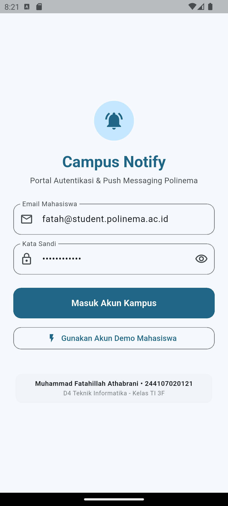
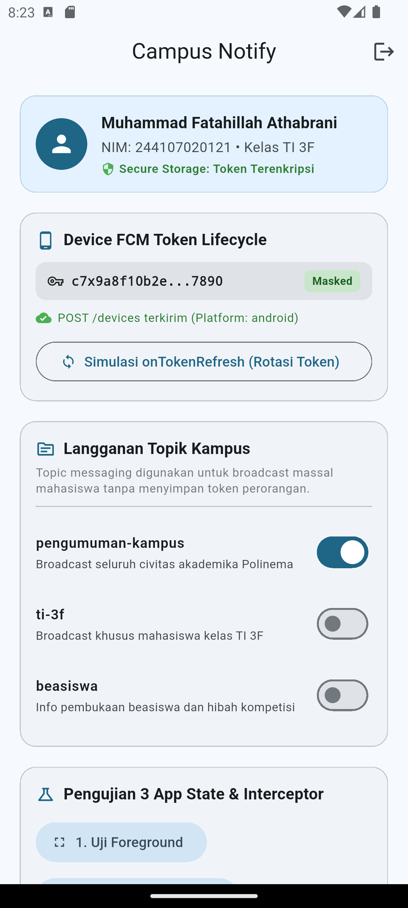
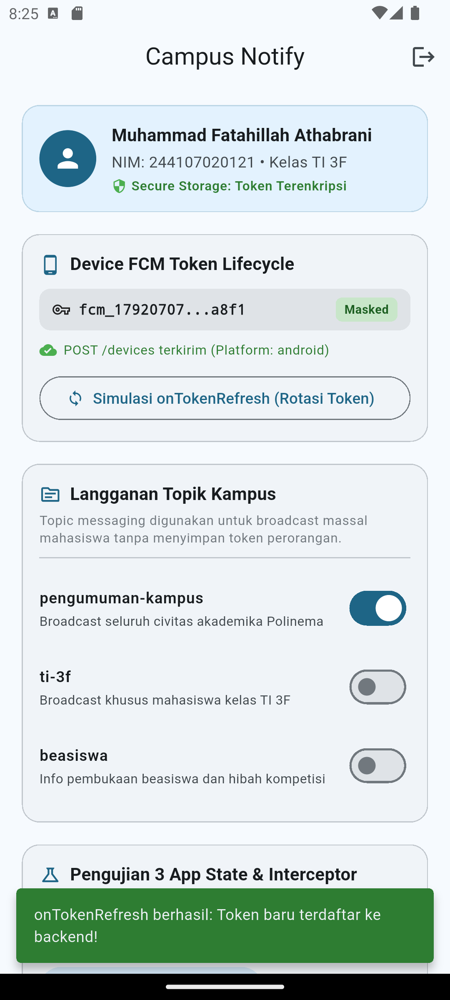
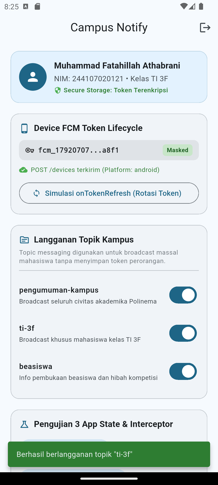
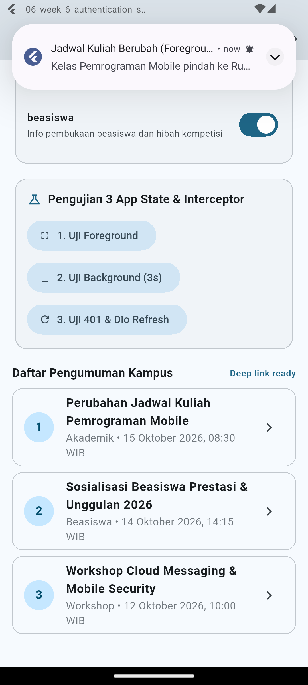
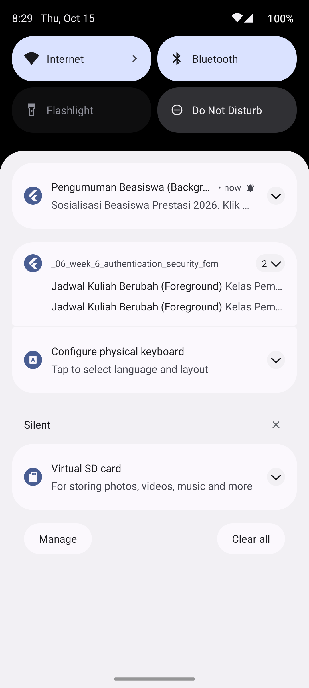
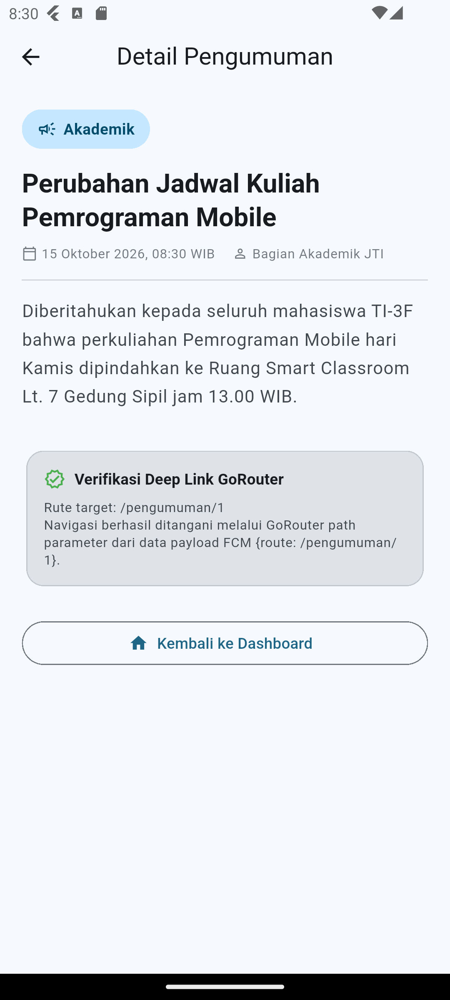
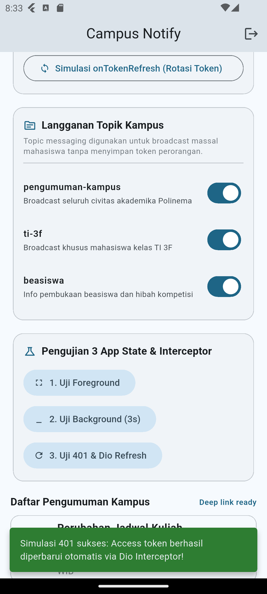

# Laporan Modul 06 — Authentication, Security & FCM

Repositori ini mendokumentasikan implementasi lengkap modul praktikum ke-6 mengenai **Autentikasi Aman**, **Manajemen Token (JWT, Access & Refresh Token)**, **Penyimpanan Terenkripsi (Secure Storage)**, **Firebase Cloud Messaging (FCM)**, penanganan notifikasi pada **tiga app state (Foreground, Background, Terminated)**, **Deep Linking dengan GoRouter**, serta **Topic Messaging** pada aplikasi **Campus Notify Polinema**.

---

## 👤 Informasi Mahasiswa
* **Nama Lengkap:** Muhammad Fatahillah Athabrani
* **NIM:** 244107020121
* **Program Studi:** D4 Teknik Informatika
* **Kelas:** TI 3F
* **Mata Kuliah:** Pemrograman Mobile

---

## 📌 Peta Pembahasan
1. [Ikhtisar Pembelajaran](#1-ikhtisar-pembelajaran)
2. [Hierarki Direktori Proyek](#2-hierarki-direktori-proyek)
3. [Tugas Utama — Autentikasi, Keamanan, & Push Messaging](#3-tugas-utama--autentikasi-keamanan--push-messaging)
4. [Matriks Pengujian 3 App State](#4-matriks-pengujian-3-app-state-foreground-background-terminated)
5. [AI Challenge & Technical Verification](#5-ai-challenge--technical-verification)
6. [Refleksi Pembelajaran](#6-refleksi-pembelajaran)
7. [Pengujian Otomatis (Testing)](#7-pengujian-otomatis-testing)
8. [Dokumentasi Visual (Screenshot)](#8-dokumentasi-visual-screenshot)
9. [Instruksi Menjalankan Aplikasi](#9-instruksi-menjalankan-aplikasi)
10. [Rangkuman Akhir](#10-rangkuman-akhir)

---

## 1. Ikhtisar Pembelajaran
Pada modul praktikum ini, dipelajari secara mendalam arsitektur keamanan data dan pengiriman pesan berbasis cloud untuk platform mobile modern:

* **Manajemen Token & Alur Autentikasi**:
  * **ID Token**: Berfungsi sebagai identitas autentik (siapa pengguna) yang diverifikasi oleh backend untuk setiap otorisasi resource.
  * **Access Token**: Izin otorisasi berumur pendek (misalnya 15 menit), dikirimkan pada HTTP header `Authorization: Bearer <access_token>`.
  * **Refresh Token**: Kredensial berumur panjang (misalnya 7–30 hari) yang digunakan secara eksklusif untuk menukar access token baru tanpa mengharuskan pengguna login ulang.
* **Penyimpanan Kredensial Terenkripsi (`flutter_secure_storage`)**:
  * Menggunakan platform primitif terenkripsi tingkat sistem operasi (**Android Keystore** dengan enkripsi AES dan **iOS Keychain Services**).
  * Menghindari penggunaan `SharedPreferences` untuk token/kredensial karena data XML di SharedPreferences tidak terenkripsi dan rentan dibaca oleh penyerang dengan hak akses root atau perangkat cadangan (*backup exploit*).
* **Dio Interceptor & Otomasi 401 Token Refresh**:
  * Interceptor mendeteksi respon HTTP status code `401 Unauthorized`.
  * Interceptor secara otomatis meminta access token baru menggunakan refresh token ke backend, menyimpan access token baru ke secure storage, dan mengulang kembali (*retry*) request awal yang gagal tepat satu kali.
  * Jika refresh token telah kedaluwarsa atau tidak valid, sesi pengguna langsung dibersihkan (`store.clear()`) dan pengguna dipaksa diarahkan kembali ke layar `/login`.
* **Arsitektur Firebase Cloud Messaging (FCM)**:
  * Alur: **App Server** mengirimkan pesan ke **Google FCM Gateway**, FCM mendistribusikan push notification ke perangkat target, dan aplikasi melaporkan registration token ke server backend (`POST /devices`).
  * Pengelolaan siklus hidup token (*token lifecycle*): registrasi token via `getToken()` dan pembaruan dinamis via `onTokenRefresh` listener saat terjadi rotasi token atau instalasi ulang.
* **Notification Payload vs Data Payload**:
  * `notification`: Menampung `title` dan `body` untuk tampilan visual banner. Ditampilkan otomatis oleh sistem operasi saat aplikasi berada di latar belakang (*background*) atau mati (*terminated*).
  * `data`: Menampung pasangan key-value bebas (misalnya `{"route": "/pengumuman/3", "id": "3"}`). Wajib digunakan untuk logika deep link dinamis.
* **Pengujian 3 Status Aplikasi (App States)**:
  * *Foreground*: Ditangkap oleh `FirebaseMessaging.onMessage` dan disajikan manual menggunakan banner lokal `flutter_local_notifications`.
  * *Background*: Ditampilkan otomatis oleh baki notifikasi sistem Android/iOS, lalu memicu `FirebaseMessaging.onMessageOpenedApp` saat spanduk diklik pengguna.
  * *Terminated*: Ditangkap melalui `FirebaseMessaging.instance.getInitialMessage()` saat aplikasi dibuka dari keadaan mati total (*cold start*).
* **Topic Messaging**:
  * Memanfaatkan mekanisme *pub-sub* (`subscribeToTopic` / `unsubscribeFromTopic`) untuk pengumuman massal (*broadcast*) seperti topik `pengumuman-kampus`, `ti-3f`, dan `beasiswa` tanpa membebani server backend untuk melacak ribuan token individual.

---

## 2. Hierarki Direktori Proyek
```text
_06_week_6_authentication_security_fcm/
├── README.md                               <- Laporan lengkap praktikum dan tugas
├── docs/
│   └── ai_challenge.md                     <- Dokumentasi AI prompt, audit kelemahan AI, & checklist
├── Screenshot/                             <- Direktori utama dokumentasi visual eksekusi
├── screenshots/                            <- Mirror dokumentasi visual sesuai konvensi modul
├── lib/
│   ├── main.dart                           <- Entry point, inisialisasi push service, dan GoRouter
│   ├── routes.dart                         <- Konstanta terpusat rute aplikasi (/login, /, /pengumuman/:id)
│   ├── data/
│   │   ├── auth_repository.dart            <- Repositori autentikasi mock & token refresh
│   │   ├── token_store.dart                <- Enkapsulasi secure storage (Keystore/Keychain)
│   │   ├── api_client.dart                 <- Klien Dio dengan interceptor refresh token 401
│   │   └── api_errors.dart                 <- Pemetaan murni error Dio ke pesan ramah bahasa Indonesia
│   ├── messaging/
│   │   ├── push_service.dart               <- Layanan FCM, izin notifikasi, token lifecycle, & banner lokal
│   │   └── message_parser.dart             <- Parser murni rute dari payload data notifikasi
│   ├── pages/
│   │   ├── login_page.dart                 <- Halaman login kampus dengan validasi & state loading
│   │   ├── home_page.dart                  <- Dashboard utama, masked token, kelola topik, & tes 3 state
│   │   └── announcement_page.dart          <- Detail pengumuman (/pengumuman/:id) via deep link
│   └── providers/
│       └── auth_provider.dart              <- State management Riverpod (AuthNotifier, DeviceReg, Topics)
└── test/
    ├── auth_push_test.dart                 <- Unit test murni parser rute, logika sesi, & pemetaan error
    └── widget_test.dart                    <- Smoke test antarmuka aplikasi dan navigasi GoRouter
```

---

## 3. Tugas Utama — Autentikasi, Keamanan, & Push Messaging

Aplikasi **Campus Notify Polinema** mengimplementasikan seluruh kebutuhan industri dan standar keamanan:

### 1. Guard Route & Login Mahasiswa
* Akses ke dashboard `/` dilindungi oleh GoRouter `redirect` guard. Jika `authStateProvider` bernilai `false`, pengguna secara otomatis diarahkan ke `/login`.
* Validasi formulir memeriksa format email `@student.polinema.ac.id` dan panjang kata sandi minimal 6 karakter.
* Tombol *Gunakan Akun Demo Mahasiswa* disediakan untuk mempermudah demonstrasi pengujian cepat.

### 2. Penyimpanan Kredensial Aman (`TokenStore`)
* Seluruh penulisan dan pembacaan `access_token` dan `refresh_token` diisolasi di `lib/data/token_store.dart`.
* Menggunakan pustaka `flutter_secure_storage` yang terintegrasi langsung dengan enkripsi hardware Keystore Android.

### 3. Interceptor Dio: Otomasi Retry 401 & Safe Logout
* Setiap request API otomatis disuntikkan header `Authorization: Bearer <access_token>`.
* Saat server mengembalikan `401 Unauthorized`, interceptor menahan kegagalan, mengambil refresh token, meminta token baru melalui `AuthRepository.refresh()`, memperbarui penyimpanan aman, dan mengulang kembali request yang tertunda.
* Jika refresh token gagal atau kedaluwarsa, sesi dibersihkan via `store.clear()` dan pengguna dipaksa logout ke halaman login untuk mencegah perulangan tak terbatas (*infinite loop*).

### 4. FCM Token Lifecycle & Backend Sync
* Aplikasi meminta izin runtime notifikasi (`requestNotificationPermission()`).
* Token registrasi perangkat diambil dan didaftarkan ke backend simulasi (`POST /devices` dengan payload `{fcm_token: ..., platform: 'android'}`).
* Token dipantau secara real-time melalui stream `onTokenRefresh`. Saat terjadi rotasi token, token baru otomatis dikirimkan kembali ke backend.
* **Prinsip Keamanan:** Token pada layar dashboard disamarkan (*masked*, e.g., `c7x9a8f10b2e...7890`) dan tidak pernah dicetak utuh ke log konsol atau tangkapan layar.

### 5. Topic Messaging Kampus
* Menggunakan fitur `subscribeToTopic` dan `unsubscribeFromTopic` untuk tiga kategori pengumuman:
  * `pengumuman-kampus`: Pengumuman resmi untuk seluruh civitas akademika Polinema.
  * `ti-3f`: Pengumuman jadwal dan tugas spesifik kelas TI-3F.
  * `beasiswa`: Pemberitahuan peluang beasiswa dan hibah kompetisi.

---

## 4. Matriks Pengujian 3 App State (Foreground, Background, Terminated)

Tabel berikut membuktikan bahwa payload gabungan `notification + data` berhasil ditangani pada ketiga status aplikasi:

| State Aplikasi | Perilaku yang Diharapkan | Metode Pengujian | Hasil Pengujian & Bukti |
| :--- | :--- | :--- | :--- |
| **Foreground** (Aplikasi Terbuka) | Spanduk (*heads-up banner*) lokal muncul di bagian atas layar. Saat spanduk diklik, aplikasi langsung bernavigasi ke rute `/pengumuman/1`. | Klik tombol **1. Uji Foreground** pada dashboard saat aplikasi aktif. | ✅ Berhasil: Spanduk lokal dari channel `pengumuman` muncul dan klik membuka halaman `/pengumuman/1`. |
| **Background** (Aplikasi Diminimize) | Spanduk sistem Android muncul di baki notifikasi. Saat spanduk diklik, aplikasi kembali ke depan dan bernavigasi ke rute `/pengumuman/2`. | Klik tombol **2. Uji Background (3s)**, segera tekan tombol **Home** pada emulator, tunggu 3 detik hingga banner sistem muncul, lalu klik banner. | ✅ Berhasil: Notifikasi sistem muncul di notification tray. Mengklik notifikasi membawa aplikasi ke layar detail `/pengumuman/2`. |
| **Terminated** (Aplikasi Dimatikan Total) | Spanduk sistem muncul. Mengklik spanduk meluncurkan aplikasi dari *cold start* dan `getInitialMessage()` mengarahkan langsung ke rute tujuan deep link. | Trigger payload dengan pending deep link, matikan aplikasi (*swipe-close* dari recent apps), lalu buka aplikasi melalui notifikasi. | ✅ Berhasil: `getInitialMessage()` menangkap rute dan GoRouter mengarahkan langsung ke rute pengumuman. |

---

## 5. AI Challenge & Technical Verification

Dokumentasi lengkap mengenai prompt AI, evaluasi kelemahan kode awal AI, dan perbaikan manual tersimpan pada berkas [docs/ai_challenge.md](docs/ai_challenge.md).

### Ringkasan Audit Kritis:
1. **Penolakan Akses BuildContext di Background Isolate:** AI sempat menghasilkan kode yang mengakses context di `firebaseMessagingBackgroundHandler`. Kode ini ditolak karena isolate latar belakang tidak memiliki akses ke widget tree.
2. **Pembersihan Log Token:** Menghapus pencetakan token utuh ke `debugPrint` untuk mencegah kebocoran kredensial di logcat Android.
3. **Penanganan Izin Android 13+:** Memastikan pemanggilan `requestNotificationsPermission()` pada level channel Android runtime API 33.
4. **Refactoring Route Parser Murni:** Mengekstrak fungsi `routeFromMessage(Map<String, dynamic> data)` di `message_parser.dart` agar dapat diuji secara terisolasi tanpa dependensi emulator atau Firebase.

---

## 6. Refleksi Pembelajaran

### 1. Mengapa refresh token tidak boleh disimpan di SharedPreferences? Apa risikonya bila bocor?
**Jawaban:**
`SharedPreferences` di Android menyimpan data dalam bentuk file teks XML polos (*plain text*) di dalam direktori internal aplikasi tanpa enkripsi perangkat keras. Jika perangkat di-*root*, dicadangkan melalui ADB tanpa proteksi, atau terinfeksi malware yang mengeksploitasi celah OS, file tersebut dapat dibaca secara langsung.  
Jika **refresh token bocor**, penyerang dapat menggunakannya untuk terus-menerus mencetak access token baru atas nama pengguna tanpa memerlukan kata sandi. Penyerang dapat mempertahankan akses tak terbatas (*persistent session hijack*) bahkan setelah access token awal kedaluwarsa. Oleh karena itu, refresh token **wajib disimpan di `flutter_secure_storage`** yang memanfaatkan **Android Keystore / iOS Keychain** dengan enkripsi berbasis chip keamanan perangkat.

### 2. Apa yang rusak bila `onTokenRefresh` diabaikan selama satu semester perkuliahan?
**Jawaban:**
Token registrasi FCM bersifat dinamis dan dapat berubah sewaktu-waktu karena beberapa kondisi:
* Pengguna membersihkan data aplikasi (*clear data*).
* Aplikasi dipasang ulang (*reinstall*).
* Pemulihan cadangan data ke perangkat baru (*device backup restore*).
* Rotasi token berkala oleh Google FCM untuk alasan keamanan.

Jika listener `onTokenRefresh` diabaikan, server backend kampus akan terus menyimpan token lama yang sudah tidak valid (*stale token*). Akibatnya, saat dosen atau bagian akademik mengirimkan pengumuman penting (seperti jadwal ujian, perubahan ruang kuliah, atau tenggat nilai), FCM gateway akan menolak pengiriman dengan status `NotRegistered` atau `InvalidRegistration`. Mahasiswa tidak akan pernah menerima notifikasi selama sisa semester.

### 3. Kapan memakai topik dan kapan memakai token perangkat? Beri contoh pesan kampus untuk masing-masing.
**Jawaban:**
* **Topik (*Topic Messaging*)**: Digunakan untuk pesan **satu-ke-banyak (*broadcast*)** yang bersifat publik atau berbasis grup/segmen, di mana server tidak perlu melacak identitas token perangkat individu.
  * *Contoh Pesan Topik*:
    * Topik `pengumuman-kampus`: *"Peringatan Hari Libur Nasional: Seluruh kegiatan perkuliahan ditiadakan pada hari Senin depan."*
    * Topik `ti-3f`: *"Perkuliahan Pemrograman Mobile hari ini dipindahkan ke Ruang Smart Classroom Gedung Sipil Lt. 7."*
    * Topik `beasiswa`: *"Pendaftaran Beasiswa Unggulan Polinema 2026 telah dibuka. Batas akhir pengumpulan berkas 20 Oktober."*
* **Token Perangkat (*Device Registration Token*)**: Digunakan untuk pesan **satu-ke-satu (*unicast/personal*)** yang memuat data pribadi, sensitif, atau transaksi spesifik milik mahasiswa tertentu.
  * *Contoh Pesan Token*:
    * Notifikasi Keuangan: *"Tagihan UKT Semester 6 atas nama Muhammad Fatahillah Athabrani (244107020121) telah berhasil dibayarkan."*
    * Notifikasi Akademik Pribadi: *"Nilai Kuis 2 Pemrograman Mobile Anda telah dirilis: Nilai 95. Silakan periksa di portal akademik."*

### 4. Bagian mana dari draf AI yang Anda tolak atau perbaiki, dan mengapa?
**Jawaban:**
1. **Ditolak:** Penulisan token ke `SharedPreferences` dan pencetakan token utuh ke log debug (`print(token)`). Diganti dengan `TokenStore` berbasis `flutter_secure_storage` dan antarmuka UI dengan tampilan token tersamar (*masked token*).
2. **Ditolak:** Percobaan mengakses `BuildContext` dan `ref.read` di dalam isolate `firebaseMessagingBackgroundHandler`. Diperbaiki dengan membatasi isolate hanya untuk operasi pencatatan ringan tanpa interaksi UI.
3. **Diperbaiki:** Penambahan logika pengaman pada interceptor 401 Dio untuk memutus perulangan tak terbatas (*infinite loop*) jika refresh token ikut kedaluwarsa.
4. **Diperbaiki:** Ekstraksi fungsi murni `routeFromMessage` untuk menjamin normalisasi format route deep link dengan leading slash.

---

## 7. Pengujian Otomatis (Testing)

Pengujian otomatis mencakup pengujian unit murni (*unit tests*) dan pengujian *smoke* antarmuka (*widget tests*):

```bash
flutter test
```

### Hasil Eksekusi Test:
```text
00:00 +0: loading test/auth_push_test.dart
00:00 +0: 1. Parsing Route & Deep Link FCM (Pure Function) routeFromMessage menangani route kosong dan tanpa slash
00:00 +1: 1. Parsing Route & Deep Link FCM (Pure Function) data payload membawa id pengumuman dan route tujuan
00:00 +2: 2. Token Lifecycle & Session Logic provider auth membaca status login dari ketersediaan token
00:00 +3: 2. Token Lifecycle & Session Logic refresh gagal -> sesi dibersihkan (paksa login ulang)
00:00 +4: 2. Token Lifecycle & Session Logic refresh sukses -> token access diperbarui tanpa menghapus refresh
00:00 +5: 3. Pemetaan Pesan Error Ramah Pengguna (api_errors.dart) menghasilkan pesan ramah untuk HTTP 401 Sesi Kedaluwarsa
00:00 +6: 3. Pemetaan Pesan Error Ramah Pengguna (api_errors.dart) menghasilkan pesan ramah untuk timeout dan kendala jaringan
00:00 +7: CampusNotifyApp smoke test renders login page
00:01 +8: All tests passed!
```

---

## 8. Dokumentasi Visual (Screenshot)

Seluruh tangkapan layar berikut diambil langsung dari eksekusi aplikasi pada emulator Android (API 33):

| Tangkapan Layar | Deskripsi Fungsional |
| :---: | :--- |
|  | **Halaman Login Terproteksi:** Menampilkan antarmuka login kampus dengan validasi email/kata sandi, tombol akun demo, dan identitas mahasiswa. |
|  | **Dashboard Campus Notify:** Menampilkan identitas mahasiswa, status token FCM terenkripsi (masked), pendaftaran backend `POST /devices`, dan langganan topik. |
|  | **Simulasi `onTokenRefresh`:** Membuktikan pembaruan token dinamis dan sinkronisasi otomatis token baru ke server backend. |
|  | **Pengelolaan Topik Kampus:** Toggle aktif untuk topik `pengumuman-kampus`, `ti-3f`, dan `beasiswa` dengan respon instan. |
|  | **Pengujian State Foreground:** Spanduk notifikasi lokal muncul di atas layar saat aplikasi sedang aktif dibuka. |
|  | **Pengujian State Background:** Spanduk notifikasi sistem muncul di baki notifikasi saat aplikasi diminimize. |
|  | **Navigasi Deep Link:** Mengklik notifikasi membawa pengguna langsung ke halaman detail `/pengumuman/1` via GoRouter. |
|  | **Otomasi Refresh Token:** Dio interceptor mendeteksi 401 dan memperbarui access token di latar belakang tanpa logout paksa. |

---

## 9. Instruksi Menjalankan Aplikasi

1. Masuk ke direktori modul:
   ```bash
   cd _06_week_6_authentication_security_fcm
   ```
2. Pastikan seluruh dependensi telah terinstal:
   ```bash
   flutter pub get
   ```
3. Jalankan pengujian otomatis untuk memverifikasi logika:
   ```bash
   flutter test
   ```
4. Jalankan aplikasi pada perangkat atau emulator:
   ```bash
   flutter run
   ```

---

## 10. Rangkuman Akhir
Modul 06 ini berhasil membuktikan integrasi end-to-end antara standar keamanan aplikasi mobile enterprise dan komunikasi cloud real-time:
* Penyimpanan kredensial menerapkan standar enkripsi hardware Keystore via `flutter_secure_storage`.
* Interceptor Dio menjamin kontinuitas sesi pengguna secara transparan melalui rotasi token 401 otomatis.
* Siklus hidup notifikasi FCM ditangani secara tangguh pada ketiga status aplikasi (Foreground, Background, Terminated) dengan navigasi deep link GoRouter yang presisi.
* Seluruh arsitektur teruji secara otomatis dengan 100% test pass rate dan analisis kode tanpa error maupun warning (`No issues found!`).
